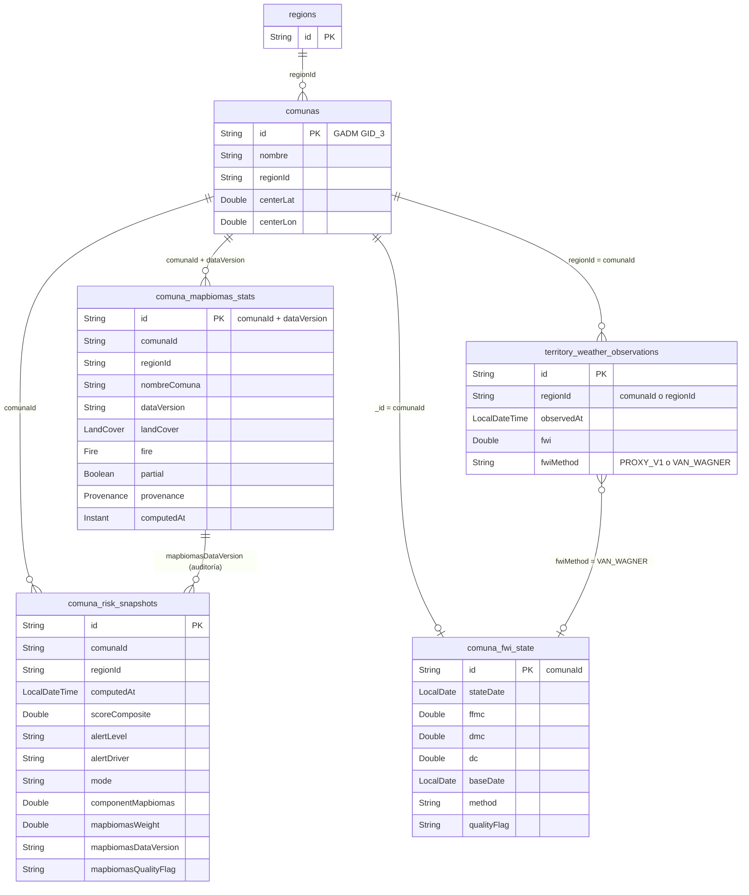
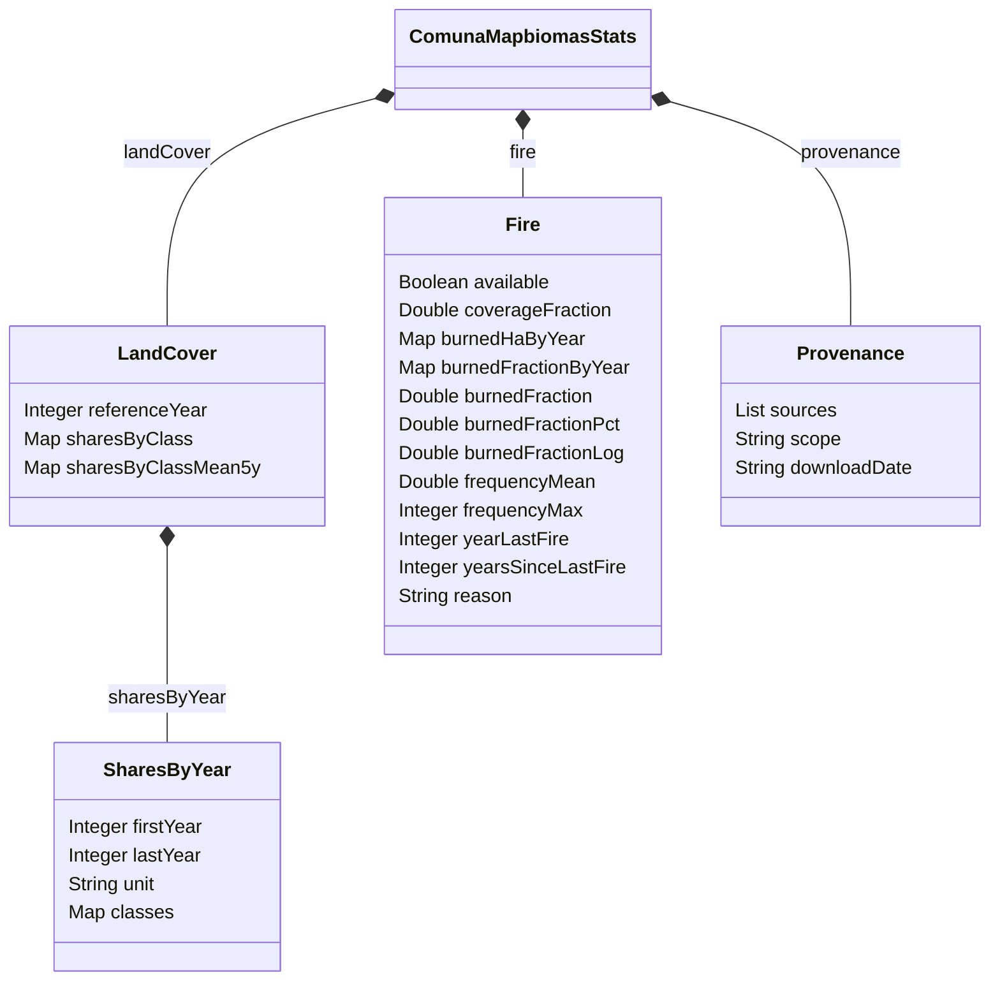

# MER — Integración MapBiomas v1

Fecha: 2026-10-12
Estado: vigente
Alcance: modelo de datos agregado o modificado por la integración MapBiomas (rama `main`, commit de merge `767caa6`)
Fuente: entidades en `Producto/backend/simfat-backend/src/main/java/com/simfat/backend/model`, `application.properties` y recursos en `src/main/resources`

Documentos relacionados:

- `Documentacion/MER/2026-06-20_nuevas_colecciones_EP3.md` (colecciones EP3)
- `Documentacion/MER/2026-06-02_mer_completo_sistema_v2.md` (modelo completo del sistema)
- `Documentacion/UML/2026-10-12_arquitectura_integracion_mapbiomas_v1.md` (arquitectura de esta integración)

---

## 1. Resumen de cambios

| Elemento | Tipo de cambio | Colección MongoDB | Origen del cambio |
|---|---|---|---|
| `ComunaMapbiomasStats` | Nueva | `comuna_mapbiomas_stats` | Semilla JSONL cargada al arranque |
| `ComunaFwiState` | Nueva | `comuna_fwi_state` | Cadena FWI Van Wagner (avance diario) |
| `ComunaRiskSnapshot` | Modificada (7 campos nuevos) | `comuna_risk_snapshots` | Mezcla de score con MapBiomas y causa de alerta |
| `TerritoryWeatherObservation` | Modificada (1 campo nuevo) | `territory_weather_observations` | Campo `fwiMethod` |
| `TerritoryRiskSnapshot` | Sin cambios | `territory_risk_snapshots` | Su campo `alertDriver` es anterior (commit `07e8bb3`, 2026-07-02) |
| `ComunaInfo` | Sin cambios | `comunas` | Solo es leída por el cargador de semilla |
| Recursos de configuración | Nuevos | (archivos del classpath) | `fuel-weights-v1.json`, `fwi-thresholds-v1.json`, semilla JSONL |

**PostgreSQL / Flyway: sin cambios.** La última migración del repositorio sigue siendo `V6__notifications.sql` (`src/main/resources/db/migration`: V1 a V6) y ningún commit de la integración agrega migraciones. Toda la integración usa MongoDB.

> Nota de nomenclatura: el documento EP3 describe el score comunal como `comunaRiskScores`. En el código la colección real es `comuna_risk_snapshots` (`@Document(collection = "comuna_risk_snapshots")`).

---

## 2. Diagrama entidad-relación

Las relaciones son lógicas (MongoDB no impone llaves foráneas). `comunaId` es el identificador GADM GID_3 de la comuna (ejemplo `CHL.13.1.1_1`), que coincide con `ComunaInfo.id`.



Estructura interna de los documentos embebidos de `comuna_mapbiomas_stats`:



---

## 3. Colección `comuna_mapbiomas_stats` (nueva)

### Propósito

Estadísticas MapBiomas por comuna: cobertura del suelo (Colección 2, 1999-2024) e historial de fuego (Fuego Colección 1, 2013-2025). Vive en una colección propia y separada de `comunas`, porque `MonitoredComunasConfig.ensureMonitoredComunas()` vuelve a guardar completo cada `ComunaInfo` en cada arranque, y cualquier campo que no setee explícitamente se perdería (decisión de diseño D1, documentada en el Javadoc de `ComunaMapbiomasStats`).

### Identidad e idempotencia

- Un documento por `(comunaId, dataVersion)`.
- `_id` determinístico: `"{comunaId}|{dataVersion}"` (método `ComunaMapbiomasStats.buildId`). Recargar la misma semilla es un upsert idempotente: no genera duplicados y es seguro en cada arranque.
- Con la semilla actual: 86 documentos (3 regiones: Biobío, Ñuble y La Araucanía), `dataVersion = lulc-col2+fuego-col1@2013-2025`.

### Campos del documento raíz

| Campo | Tipo | Descripción | Fuente |
|---|---|---|---|
| `_id` | String | `"{comunaId}\|{dataVersion}"`, llave de upsert | Calculado por el cargador |
| `comunaId` | String | GADM GID_3 de la comuna (ejemplo `CHL.13.1.1_1`) | Semilla (`comunaId`) |
| `regionId` | String | Región de la comuna (`biobio`, `nuble`, `araucania`) | `ComunaInfo.regionId` (no está en la semilla) |
| `nombreComuna` | String | Nombre legible | `ComunaInfo.nombre` (no está en la semilla) |
| `dataVersion` | String | Versión de los datos; fija el conjunto leído por el scoring | Propiedad `mapbiomas.seed.data-version` |
| `landCover` | Objeto | Cobertura del suelo (sección 3.1); `null` si no hay datos de cobertura | Semilla (`landCover`) |
| `landCoverReason` | String | Motivo por el que `landCover` es `null`; la semilla vigente no lo trae (queda `null`) | Semilla (opcional) |
| `fire` | Objeto | Historial de fuego (sección 3.2) | Semilla (`fire`) |
| `fireReason` | String | Motivo por el que falta `fire`; la semilla vigente no lo trae (queda `null`) | Semilla (opcional) |
| `partial` | Boolean | `true` si alguna de las dos fuentes es parcial; en la semilla vigente es `false` en las 86 comunas | Semilla (`partial`, por defecto `false`) |
| `provenance` | Objeto | Procedencia de los datos (sección 3.3) | Semilla (`provenance`) |
| `computedAt` | Instant | Momento en que el pipeline generó el registro (UTC) | Semilla (`computedAt`, se normaliza `+00:00` a `Z`) |

### 3.1 Subdocumento `landCover`

| Campo | Tipo | Descripción |
|---|---|---|
| `referenceYear` | Integer | Año de referencia para los índices (2024 en la semilla vigente) |
| `sharesByClass` | Map<String, Double> | Fracción (0 a 1) de cada clase de cobertura en el año de referencia. Las fracciones suman aproximadamente 1,0 |
| `sharesByClassMean5y` | Map<String, Double> | Fracción promedio de los últimos 5 años |
| `sharesByYear` | Objeto | Serie anual completa (ver abajo) |

`sharesByYear` (serie por clase, escasa y en puntos base):

| Campo | Tipo | Descripción |
|---|---|---|
| `firstYear` | Integer | Primer año de la serie (1999) |
| `lastYear` | Integer | Último año de la serie (2024) |
| `unit` | String | `"bp"` (puntos base, 0 a 10000) |
| `classes` | Map<String, int[]> | Por código de clase, arreglo de largo `lastYear - firstYear + 1`; el índice `i` corresponde al año `firstYear + i`. Una clase ausente en un año vale 0; una clase ausente en todos los años no aparece como llave |

Regla de unidades: `sharesByClass` y `sharesByClassMean5y` son **fracciones (0 a 1)**; solo `sharesByYear.classes` está en **puntos base (0 a 10000)**.

Validaciones del cargador (rechazan la línea completa y la cuentan como error): largo de cada arreglo igual a `lastYear - firstYear + 1`; `firstYear` y `lastYear` no nulos; para cada clase de `sharesByClass`, la diferencia con `sharesByYear[referenceYear] / 10000` es de a lo más `1e-4`.

Clases presentes en la semilla vigente (16): 9, 11, 12, 15, 18, 23, 24, 25, 27, 29, 33, 34, 59, 60, 66, 67. Las etiquetas están en `MapbiomasLandCoverLegend` (por ejemplo 9 = Silvicultura, 18 = Agricultura, 59 = Bosque Primario, 60 = Bosque Secundario, 66 = Matorral, 27 = No observado).

### 3.2 Subdocumento `fire`

| Campo | Tipo | Descripción |
|---|---|---|
| `available` | Boolean | `true` si hay datos de fuego utilizables para la comuna (las 86 comunas de la semilla vigente) |
| `coverageFraction` | Double | Fracción de la comuna cubierta por la extensión del raster de Fuego (compuerta de cobertura, umbral 0,95 en el pipeline) |
| `burnedHaByYear` | Map<String, Double> | Hectáreas quemadas por año (llaves `"2013"` a `"2025"`) |
| `burnedFractionByYear` | Map<String, Double> | Fracción de la superficie comunal quemada por año |
| `burnedFraction` | Double | Fracción quemada acumulada: **unión a nivel de píxel** sobre 2013-2025, nunca la suma de las fracciones anuales (evita doble conteo) |
| `burnedFractionPct` | Double | Rango percentil empírico de `burnedFraction` entre todas las comunas (empates con rango medio, ceros exactos fijados en 0,0). Es el `burnedNorm` del score. Solo no nulo si `available = true` |
| `burnedFractionLog` | Double | Variante `log1p` con recorte en p95; normalización alternativa configurable. Misma regla de nulidad |
| `frequencyMean` | Double | Frecuencia media de quemas por píxel en 2013-2025 |
| `frequencyMax` | Integer | Frecuencia máxima en la comuna |
| `yearLastFire` | Integer | Último año con fuego (corregido en el pipeline para no contradecir `burnedFractionByYear`) |
| `yearsSinceLastFire` | Integer | Años transcurridos desde el último fuego respecto de 2025 |
| `reason` | String | Solo no nulo cuando `available = false`; explica por qué |

### 3.3 Subdocumento `provenance`

| Campo | Tipo | Descripción |
|---|---|---|
| `sources` | List<String> | Archivos de origen (planilla de cobertura Col 2 y rasters de Fuego Col 1, incluido el producto acumulado usado solo como verificación cruzada) |
| `scope` | String | Descripción del alcance (cobertura 1999-2024, Fuego 2013-2025, fecha de descarga) |
| `downloadDate` | String | Fecha de descarga (`2026-09-30` en la semilla vigente) |

El detalle de hash sha256 por archivo fuente se mantiene fuera de MongoDB, en `Producto/analytics/mapbiomas/data/manifest.json`.

### Índices declarados

Con `spring.data.mongodb.auto-index-creation=true` se crean al arranque:

| Nombre | Definición | Uso |
|---|---|---|
| `idx_region_dataversion` | `{ regionId: 1, dataVersion: 1 }` | Lectura de capas públicas por región (`findByRegionIdAndDataVersion`) |
| `idx_comuna_dataversion_desc` | `{ comunaId: 1, dataVersion: -1 }` | Lectura por comuna (`findByComunaIdAndDataVersion`) |

### Consultas del repositorio

`findByComunaId`, `findByComunaIdAndDataVersion`, `findByRegionId`, `findByDataVersion` (lectura masiva por corrida de scoring) y `findByRegionIdAndDataVersion`.

### Relaciones

- `comunaId` → `comunas._id` (`ComunaInfo`), 1 comuna : N versiones de datos.
- `regionId` → `regions._id`, copiado desde `ComunaInfo` al cargar.
- El scoring y las capas públicas leen una sola `dataVersion`, fijada por la propiedad `mapbiomas.stats.data-version`. Una futura actualización de colecciones es un cambio de configuración y una nueva semilla, no un cambio de código.

---

## 4. Colección `comuna_fwi_state` (nueva)

### Propósito

Estado actual de la cadena del Índice Meteorológico de Incendios canadiense (Van Wagner y Pickett, 1985) por comuna. Un documento por comuna (`_id = comunaId`) con solo el estado vigente, no un historial. Los campos `base*` guardan el estado al cierre del día anterior a `stateDate`, de modo que una segunda sincronización del mismo día calendario (el cron corre dos veces al día) recalcula desde la base en lugar de acumular dos veces.

### Campos

| Campo | Tipo | Descripción | Fuente |
|---|---|---|---|
| `_id` | String | `comunaId` | `ComunaFwiStateService` |
| `stateDate` | LocalDate | Día calendario hasta el cual se avanzó la cadena | Fecha objetivo de la sincronización |
| `ffmc` | Double | Fine Fuel Moisture Code al cierre de `stateDate` | `CanadianFwiCalculator` |
| `dmc` | Double | Duff Moisture Code al cierre de `stateDate` | `CanadianFwiCalculator` |
| `dc` | Double | Drought Code al cierre de `stateDate` | `CanadianFwiCalculator` |
| `baseDate` | LocalDate | Un día antes de `stateDate` | Calculado |
| `baseFfmc` | Double | FFMC al cierre de `baseDate` | Estado previo |
| `baseDmc` | Double | DMC al cierre de `baseDate` | Estado previo |
| `baseDc` | Double | DC al cierre de `baseDate` | Estado previo |
| `method` | String | Siempre `"VAN_WAGNER"` por ahora; es un campo para permitir otros métodos sin migración | Constante del servicio |
| `qualityFlag` | String | `null` en el caso normal; `FWI_WARMUP` en el primer arranque en frío de la comuna; `FWI_RESTARTED` si un hueco superior al máximo forzó reinicio. Vuelve a `null` en el siguiente avance normal | `ComunaFwiStateService` |
| `updatedAt` | LocalDateTime | Solo observabilidad; ninguna lógica lo lee | Servicio |

### Reglas de avance (`ComunaFwiStateService.advance`)

| Caso | Resultado |
|---|---|
| Sin estado previo | Arranque en frío con valores publicados (FFMC 85, DMC 6, DC 15), `qualityFlag = FWI_WARMUP` |
| `targetDate == stateDate` | Recalcula desde `base*` (idempotente por día) |
| `targetDate == stateDate + 1` | Avance normal: el estado vigente pasa a ser la nueva base |
| Hueco mayor que 3 días (`DEFAULT_MAX_GAP_DAYS`) | Reinicio desde valores de arranque, `qualityFlag = FWI_RESTARTED` |
| Hueco de 2 a 3 días | Lanza `UnsupportedOperationException` (no se inventa un reemplazo) |
| `targetDate < stateDate` | Lanza `IllegalArgumentException` |

No implementados en esta versión (campos futuros nulos, sin migración): regla de inicio de temporada y sobreinvernada del DC.

### Índices

Sin índices adicionales al de `_id`. El repositorio (`ComunaFwiStateRepository`) solo usa `findById` y `save`.

### Cuándo se escribe

Solo cuando `territory.fwi.method = VAN_WAGNER` **y** el `regionId` de la sincronización es una comuna monitoreada real (`ComunaInfoRepository.existsById`). Con el valor por defecto `PROXY_V1` la colección no se usa. Si faltan las entradas de mediodía o la cadena lanza una excepción, se vuelve al proxy y se registra una advertencia.

### Relaciones

- `_id` → `comunas._id` (1:1).
- Cada avance también escribe una observación en `territory_weather_observations` con `fwiMethod = VAN_WAGNER` y los valores `ffmc`, `dmc`, `dc`, `isi`, `bui`, `dsr`.

---

## 5. Colección `comuna_risk_snapshots` (modificada)

### Propósito

Snapshot de riesgo por comuna y por ciclo de cálculo (cron `0 30 1,13 * * *` por defecto). Se agregan 7 campos: uno por la causa de la alerta y seis por la mezcla del score con MapBiomas. Los documentos anteriores a estos cambios leen `null` en los campos nuevos.

### Campos (existentes y nuevos)

| Campo | Tipo | Estado | Descripción |
|---|---|---|---|
| `_id` | String | Existente | Identificador del snapshot |
| `comunaId` | String | Existente | GADM GID_3 |
| `regionId` | String | Existente | Región |
| `nombreComuna` | String | Existente | Nombre legible |
| `computedAt` | LocalDateTime | Existente | Momento del cálculo |
| `scoreComposite` | Double | Existente | Score final (0 a 1), ya mezclado con MapBiomas cuando el peso efectivo es mayor que 0 |
| `alertLevel` | String | Existente | `NORMAL`, `PREVENTIVO`, `ALTO` o `CRITICO` (sin tilde en el código) |
| `alertDriver` | String | **Nuevo** (commit `ac3b24c`, 2026-10-12) | Regla que determinó `alertLevel`: `SCORE`, `FWI`, `FIRMS_TODAY`, `FIRMS_CLUSTER` o `FIRMS_FRP`. `null` en snapshots previos |
| `mode` | String | Existente | `STANDARD` o `ENHANCED` (con Copernicus NDVI/NDMI) |
| `qualityFlag` | String | Existente | `null` o `COPERNICUS_UNAVAILABLE` (solo dominio Copernicus) |
| `componentFwi` | Double | Existente | Contribución del FWI; se escala por `(1 - wEff)` |
| `componentFirms` | Double | Existente | Contribución de FIRMS; se escala por `(1 - wEff)` |
| `componentReports` | Double | Existente | Contribución de reportes ciudadanos; se escala por `(1 - wEff)` |
| `componentNdmi` | Double | Existente | Solo modo ENHANCED; se escala por `(1 - wEff)` |
| `componentNdvi` | Double | Existente | Solo modo ENHANCED; se escala por `(1 - wEff)` |
| `componentLoss` | Double | Existente | Pérdida forestal; hoy se persiste `null` |
| `openeoObservationId` | String | Existente | Observación Copernicus utilizada |
| `fwiRaw` | Double | Existente | FWI crudo de la última observación de la comuna |
| `firmsCount` | Integer | Existente | Focos FIRMS en 48 h |
| `firmsFrpMean` | Double | Existente | FRP medio de esos focos |
| `reportsCount` | Integer | Existente | Reportes ciudadanos en 7 días |
| `ndmiRaw`, `ndviRaw` | Double | Existente | Valores crudos Copernicus |
| `componentMapbiomas` | Double | **Nuevo** | `wEff × S_mapbiomas`, redondeado a 4 decimales; contribución persistida de MapBiomas |
| `mapbiomasFuelIndex` | Double | **Nuevo** | Índice de combustible (`fuel`, 0 a 1) tal como lo entrega `MapbiomasSusceptibility`; `null` si no hay cobertura |
| `mapbiomasHistoryIndex` | Double | **Nuevo** | Índice de historial de fuego (`history`, 0 a 1); `null` si no hay datos de fuego |
| `mapbiomasWeight` | Double | **Nuevo** | Peso efectivo `wEff` usado en este snapshot (no el `wM` configurado): 0 si faltan datos o el indicador es `MAPBIOMAS_UNAVAILABLE` |
| `mapbiomasDataVersion` | String | **Nuevo** | `dataVersion` de la que salió el resultado (auditoría) |
| `mapbiomasQualityFlag` | String | **Nuevo** | Banderas separadas por coma: `MAPBIOMAS_FUEL_UNAVAILABLE`, `MAPBIOMAS_FIRE_UNAVAILABLE`, `MAPBIOMAS_UNAVAILABLE`, `MAPBIOMAS_BURNED_NORM_RAW_FALLBACK`. Campo propio para no pisar `qualityFlag` |

### Fórmula persistida

```
S_dyn          = score STANDARD o ENHANCED (antes de MapBiomas)
wEff           = MAPBIOMAS_WEIGHT  si hay resultado y no es MAPBIOMAS_UNAVAILABLE; 0 en otro caso
scoreComposite = clamp( (1 - wEff) * S_dyn + wEff * S_mapbiomas )
componente_i   = componente_i * (1 - wEff)        (FWI, FIRMS, reportes, NDMI, NDVI)
componentMapbiomas = round4( wEff * S_mapbiomas )
```

Con `wEff = 0` (valor por defecto) todos los componentes se multiplican por 1,0: el resultado es idéntico al anterior a la integración.

### Índices declarados

| Nombre | Definición |
|---|---|
| `idx_comuna_risk_computed_desc` | `{ comunaId: 1, computedAt: -1 }` |
| `idx_region_computed_desc` | `{ regionId: 1, computedAt: -1 }` |

### Exposición por API

`GET /api/territory/risk-score/comunas/{regionId}` devuelve `alertDriver` junto a `alertLevel`, `scoreComposite`, `mode`, `qualityFlag`, valores crudos, `components` (fwi, firms, reports, ndmi, ndvi) y `fwiInputs` (derivado de la última observación meteorológica, **no persistido** en el snapshot). Los campos `mapbiomas*` y `componentMapbiomas` **no** se exponen en esa respuesta; la interfaz consulta el peso efectivo a través de `GET /api/territory/public/mapbiomas/{comunaId}` (ver documento de arquitectura).

---

## 6. Colección `territory_weather_observations` (modificada)

Se agrega un campo; el resto del documento no cambia.

| Campo | Tipo | Descripción | Fuente |
|---|---|---|---|
| `fwiMethod` | String | Método que produjo `fwi`, `ffmc`, `dmc`, `dc`, `isi`, `bui` y `dsr`: `PROXY_V1` (aproximación con Open-Meteo, `LegacyProxyFwiCalculator`) o `VAN_WAGNER` (cadena real). Los documentos anteriores a 2026-09-22 no tienen el campo y **todo lector debe interpretar `null` como `PROXY_V1`** | `OpenWeatherFwiServiceImpl` (commit `26233fb`) |

Los índices existentes no cambian (`idx_weather_region_observed_desc` y el único `uk_weather_region_observed`, ambos sobre `regionId` y `observedAt`). Para las comunas, `regionId` contiene el `comunaId`.

---

## 7. `territory_risk_snapshots` y `comunas`: sin cambios

- `TerritoryRiskSnapshot` (riesgo regional) no fue modificada por la integración. Su campo `alertDriver` (valores como `FIRMS_HOY`, `FIRMS_COUNT`, `FIRMS_FRP`, `FWI`, `SCORE_WLC`) existe desde el 2026-07-02. No contiene campos MapBiomas.
- `ComunaInfo` (`comunas`) no se modifica: el cargador de semilla solo la lee para obtener `regionId` y `nombre`.

---

## 8. Recursos de semilla y configuración versionados

Archivos en el repositorio (no son colecciones, pero forman parte del modelo de datos de la integración).

| Recurso | Ruta | Consumidor | Contenido |
|---|---|---|---|
| Semilla MapBiomas | `src/main/resources/seed/mapbiomas/comuna-mapbiomas-stats.lulc-col2+fuego-col1-2013-2025.jsonl` | `MapbiomasSeedLoader` | 86 líneas JSONL, una por comuna, con las claves `comunaId`, `landCover`, `fire`, `provenance`, `computedAt` y `partial` |
| Pesos de combustible | `src/main/resources/mapbiomas/fuel-weights-v1.json` | `FuelWeightTable` | `classWeights` por código de clase, `excludedClasses` (`["27"]`) y `provenance` |
| Umbrales FWI | `src/main/resources/fwi/fwi-thresholds-v1.json` | `FwiThresholdTable` | Umbrales `alto`, `critico`, `max` y bandera `calibrated` por método |
| Pipeline fuente de la semilla | `Producto/analytics/mapbiomas/data/comuna-mapbiomas-stats.lulc-col2+fuego-col1-2013-2025.jsonl` | Pipeline Python | Copia generada por `scripts/generate_landcover_seed.py` |

### 8.1 Semilla JSONL

- Se carga al evento `ComunaGeometrySeededEvent` (publicado por `MonitoredComunasConfig` tras sembrar las comunas), para que `ComunaInfo` exista antes.
- Si `mapbiomas.seed.enabled = false` se omite la carga; si falta el archivo se registra advertencia y no se carga nada.
- Si una comuna de la semilla no existe en `comunas`, la línea se omite (`skipped_no_comuna`).
- Resultado de la carga (`SeedLoadSummary.status`): `ok`, `degraded` (algunas líneas fallaron pero al menos una se cargó), `failed` (todas fallaron) o `empty_result` (sin errores de línea pero nada persistido). Se registra en el log como `mapbiomas_seed status=... dataVersion=... loaded=... skipped=... errors=...`.
- El mapeador es tolerante a campos desconocidos (`FAIL_ON_UNKNOWN_PROPERTIES = false`) solo para la semilla; la configuración Jackson de la API no cambia.

### 8.2 `fuel-weights-v1.json`

Tabla ordinal de literatura, **no calibrada empíricamente** (`calibratedOnSeasons = null`).

| Código | Clase | Peso |
|---|---|---|
| 9 | Silvicultura | 1,00 |
| 66 | Matorral | 0,80 |
| 12 | Pastizal | 0,60 |
| 15 | Pastura | 0,50 |
| 3, 59, 60, 67 | Bosque (general, primario, secundario, achaparrado) | 0,40 |
| 18, 63 | Agricultura, Estepa | 0,30 |
| 11 | Humedal | 0,10 |
| 29 | Afloramiento rocoso | 0,05 |
| 24, 33, 34, 25, 23, 61 | Infraestructura, agua, hielo, otra sin vegetación, arena/playa/duna, salar | 0,00 |

La clase 27 ("No observado") está en `excludedClasses`: no entra a la suma ponderada y su proporción se informa aparte como `unobservedShare`. Numéricamente equivale a un peso 0, pero se mantiene separada para no afirmar que "no hay combustible" donde en realidad "no se sabe qué hay". Un código de clase desconocido (ni ponderado ni excluido) lanza `IllegalArgumentException`.

### 8.3 `fwi-thresholds-v1.json`

| Método | `alto` | `critico` | `max` | `calibrated` |
|---|---|---|---|---|
| `PROXY_V1` | 20,0 | 45,0 | 50,0 | `true` (valores ya en producción) |
| `VAN_WAGNER` | 20,0 | 45,0 | 50,0 | `false` (marcador provisional; falta calibración por cuantiles) |

Observación: `FwiThresholdTable` carga y expone esta tabla, pero en el código actual ningún servicio de riesgo la consume; `ComunaRiskServiceImpl` usa las constantes `FWI_ALTO = 20.0`, `FWI_CRITICO = 45.0` y `FWI_MAX = 50.0`.

---

## 9. Reglas de integridad y consideraciones

| Regla | Dónde se aplica |
|---|---|
| `_id` de `comuna_mapbiomas_stats` único por comuna y versión | Construcción determinística del id (upsert) |
| Sumas de fracciones aproximadamente 1,0 (tolerancia 0,01) | `MapbiomasSusceptibilityServiceImpl.computeFuelIndex` lanza excepción ante un desajuste de unidades (puntos base frente a fracción) |
| Consistencia entre `sharesByClass` y `sharesByYear` (1e-4) | `MapbiomasSeedLoader.validateSharesByYear` |
| Datos faltantes nunca bajan el score | `wEff = 0` si no hay documento o `MAPBIOMAS_UNAVAILABLE`; con solo uno de los dos componentes, el score es ese componente (no `0,65×0` ni `0,35×0`) |
| Peso `MAPBIOMAS_WEIGHT` restringido a la grilla preregistrada `{0,0; 0,10; 0,25; 0,35; 0,50}` | `@PostConstruct` de `ComunaRiskServiceImpl`; un valor fuera de la grilla impide el arranque |
| Sin llaves foráneas físicas | Todas las referencias (`comunaId`, `regionId`) son lógicas |

## 10. Pendiente de verificación

- El detalle de los hashes de los archivos fuente solo está en `Producto/analytics/mapbiomas/data/manifest.json`; no se replica en MongoDB.
- La correspondencia entre prefijos GADM (`CHL.3`, `CHL.6`, `CHL.13`) y cada región no se documenta aquí porque no se verificó contra la fuente GADM; el modelo usa `regionId` de `ComunaInfo`.
