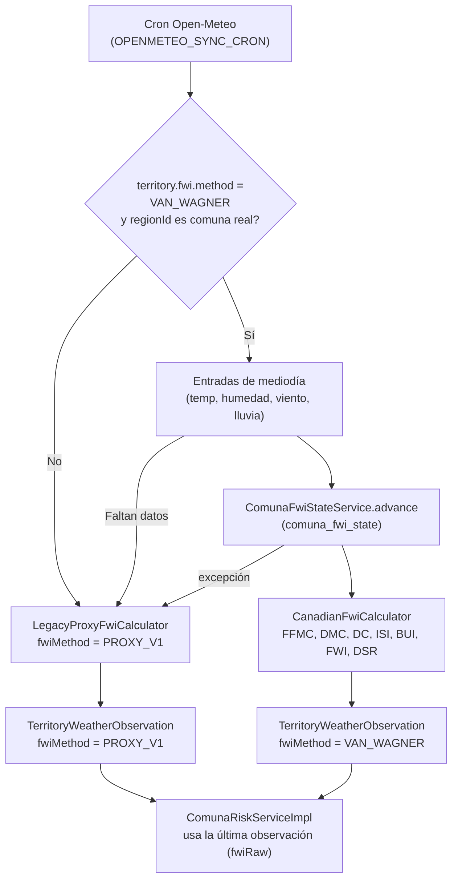
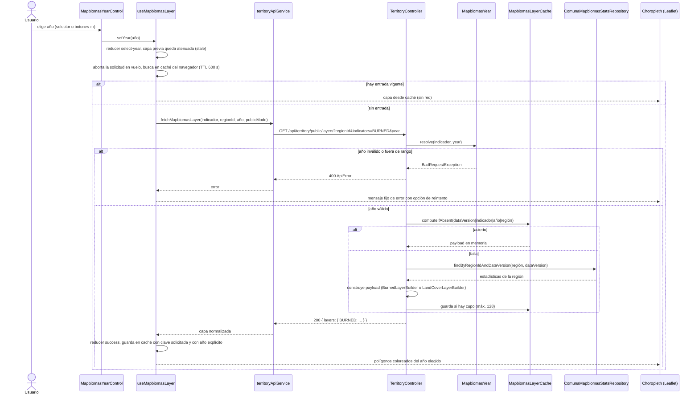
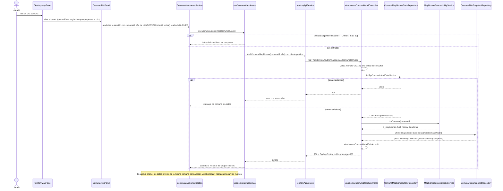

# Arquitectura — Integración MapBiomas v1

Fecha: 2026-10-12
Estado: vigente
Alcance: componentes, flujos y contratos agregados por la integración MapBiomas (rama `main`, commit de merge `767caa6`)

Documentos relacionados:

- `Documentacion/MER/2026-10-12_mer_integracion_mapbiomas_v1.md` (modelo de datos de esta integración)
- `Documentacion/UML/2026-06-02_arquitectura_integrada_sistema_completo_v2.md` (arquitectura general)
- `Documentacion/UML/2026-06-01_arquitectura_choropleth_comunal_sdd_v1.md` (choropleth comunal sobre el que se apoya)

---

## 1. Visión general

La integración incorpora datos de MapBiomas Chile (cobertura del suelo Colección 2, 1999-2024, y Fuego Colección 1, 2013-2025) en tres frentes:

1. **Contexto visual**: dos capas anuales públicas (`LANDCOVER` y `BURNED`) y una sección MapBiomas en el panel de cada comuna.
2. **Score de riesgo**: una mezcla convexa opcional entre el score dinámico y un índice de susceptibilidad MapBiomas, controlada por `MAPBIOMAS_WEIGHT` (valor por defecto 0,0, es decir, **desactivada**).
3. **FWI real**: una cadena Van Wagner (FFMC, DMC, DC) por comuna, activable con `TERRITORY_FWI_METHOD`, que convive con el proxy anterior (`PROXY_V1`).

Ningún raster se lee en tiempo de ejecución: un pipeline Python offline genera una semilla JSONL versionada que el backend carga a MongoDB.

---

## 2. Diagrama de componentes

```mermaid
flowchart LR
    subgraph OFFLINE["Fuera de línea (Producto/analytics)"]
        direction TB
        PIPE["Pipeline mapbiomas<br/>(mb_pipeline: lulc, fire_stats,<br/>zonal, build_stats)"]
        SEEDGEN["scripts/generate_landcover_seed.py"]
        MAN["data/manifest.json<br/>(sha256 de fuentes)"]
        STUDY["Estudio preregistrado<br/>(Producto/analytics/study)"]
        PIPE --> SEEDGEN
        PIPE -.-> MAN
        MAN -.-> STUDY
    end

    subgraph SRC["Fuentes externas"]
        MB["MapBiomas Chile<br/>(Col 2 cobertura, Fuego Col 1)"]
        OMF["Open-Meteo<br/>(forecast + archive)"]
        FIRMS["NASA FIRMS"]
        COP["Copernicus<br/>(openeo-service)"]
    end

    MB --> PIPE
    OMF --> STUDY
    FIRMS --> STUDY

    subgraph BE["Backend Spring Boot"]
        direction TB
        SEED[("seed/mapbiomas/<br/>*.jsonl")]
        LOADER["MapbiomasSeedLoader<br/>(ComunaGeometrySeededEvent)"]
        FUEL["FuelWeightTable<br/>fuel-weights-v1.json"]
        SUSC["MapbiomasSusceptibilityService<br/>S = 0,65 fuel + 0,35 history"]
        FWI["OpenWeatherFwiServiceImpl<br/>+ ComunaFwiStateService<br/>+ CanadianFwiCalculator"]
        SPIN["FwiSpinUpRunner<br/>(ApplicationRunner, manual)"]
        RISK["ComunaRiskServiceImpl<br/>mezcla de score + alertDriver"]
        TC["TerritoryController<br/>/api/territory/public/layers"]
        CACHE["MapbiomasLayerCache<br/>(máx. 128 entradas)"]
        DET["MapbiomasComunaDetailController<br/>/api/territory/public/mapbiomas/{comunaId}"]
        SEED --> LOADER
    end

    subgraph DB["MongoDB"]
        STATS[("comuna_mapbiomas_stats")]
        FWIST[("comuna_fwi_state")]
        WOBS[("territory_weather_observations")]
        SNAP[("comuna_risk_snapshots")]
        COM[("comunas")]
    end

    SEEDGEN -->|"copia versionada en el repo"| SEED
    LOADER -->|"upsert por comunaId y dataVersion"| STATS
    LOADER -.->|"lee regionId y nombre"| COM
    FUEL --> SUSC
    STATS --> SUSC
    OMF --> FWI
    OMF --> SPIN
    SPIN --> FWI
    FWI <--> FWIST
    FWI --> WOBS
    WOBS --> RISK
    COP --> RISK
    SUSC --> RISK
    RISK --> SNAP
    STATS --> TC
    TC <--> CACHE
    STATS --> DET
    SUSC --> DET
    SNAP -->|"mapbiomasWeight efectivo"| DET

    subgraph FE["Frontend React (features/territory)"]
        direction TB
        HUK["useTerritoryLayers"]
        HML["useMapbiomasLayer<br/>(BURNED / LANDCOVER)"]
        YC["MapbiomasYearControl"]
        LTG["LayerToggleGroups"]
        MAP["TerritoryMapPanel<br/>(BurnedChoropleth, LandcoverChoropleth)"]
        RS["RegionalSummary"]
        CRP["ComunaRiskPanel"]
        CMS["ComunaMapbiomasSection"]
        HCM["useComunaMapbiomas"]
        HUK --> HML
        LTG --> HUK
        YC --> HML
        HML --> MAP
        CRP --> CMS
        CMS --> HCM
        MAP --> CRP
        MAP --> RS
    end

    HML -->|"GET layers?indicators&year"| TC
    HCM -->|"GET mapbiomas/{id}?year"| DET
    SNAP -.->|"riskscore/comunas + alertDriver"| MAP
```



### Responsabilidades

| Componente | Capa | Responsabilidad |
|---|---|---|
| Pipeline `Producto/analytics/mapbiomas` | Offline | Estadísticas zonales por comuna a partir de los rasters; procedencia con sha256 (`data/manifest.json`); genera la semilla JSONL |
| `MapbiomasSeedLoader` | `config` | Carga la semilla al evento `ComunaGeometrySeededEvent`; upsert idempotente; valida largos de series y consistencia de unidades |
| `ComunaMapbiomasStats` y repositorio | `model`, `repository` | Documento por `(comunaId, dataVersion)`; consultas por comuna, región y versión |
| `FuelWeightTable` | `service.mapbiomas` | Carga `fuel-weights-v1.json`; falla de forma explícita ante un recurso ausente o una clase desconocida |
| `MapbiomasSusceptibilityService` | `service.mapbiomas` | Calcula `fuel`, `history` y `S_mapbiomas` por comuna; lectura individual (`forComuna`) y masiva (`forComunas`, una consulta por corrida) |
| `ComunaFwiStateService`, `CanadianFwiCalculator` | `service.fwi` | Avance diario idempotente de la cadena FWI y persistencia en `comuna_fwi_state` |
| `OpenWeatherFwiServiceImpl` | `service.impl` | Elige el método (`PROXY_V1` o `VAN_WAGNER`) y registra `fwiMethod` en cada observación |
| `FwiSpinUpRunner` | `config` | Relleno inicial único (manual) de la cadena con historial de Open-Meteo Archive |
| `ComunaRiskServiceImpl` | `service.impl` | Calcula el score, aplica la mezcla con MapBiomas, resuelve el nivel de alerta y su causa, y persiste el snapshot |
| `TerritoryController` | `controller` | Capas públicas `BURNED` y `LANDCOVER` con validación de año y caché acotada |
| `MapbiomasComunaDetailController` | `controller` | Detalle público por comuna |
| `MapbiomasLayerCache` | `web` | Caché en memoria con tope duro de entradas |
| Estudio `Producto/analytics/study` | Offline | Validación preregistrada de la mezcla (ver sección 9) |
| Frontend `features/territory` | React | Capas, selector de año, panel de comuna y resumen regional |

---

## 3. Cálculo del score con mezcla MapBiomas

### 3.1 Susceptibilidad `S_mapbiomas` (`MapbiomasSusceptibilityServiceImpl`)

```
fuel         = clamp( Σ share_clase × peso_clase )        (clase 27 excluida; share = sharesByClass del año de referencia)
burnedNorm   = fire.burnedFractionPct                      (si es nulo: fracción del año más reciente + bandera MAPBIOMAS_BURNED_NORM_RAW_FALLBACK)
recurrenceNorm = min(frequencyMean, 5) / 5
recency      = 1 + R_MAX × exp(-yearsSinceLastFire / TAU)   (R_MAX = 0,0 por defecto: recency = 1,0)
history      = clamp( (0,60 × burnedNorm + 0,40 × recurrenceNorm) × recency )
S_mapbiomas  = clamp( 0,65 × fuel + 0,35 × history )
```

Degradación (el dato ausente nunca baja el score):

| Situación | Score | `qualityFlag` |
|---|---|---|
| Cobertura y fuego disponibles | `0,65 fuel + 0,35 history` | `null` |
| Sin cobertura | `history` solo | `MAPBIOMAS_FUEL_UNAVAILABLE` |
| Sin fuego (`fire.available = false`) | `fuel` solo | `MAPBIOMAS_FIRE_UNAVAILABLE` |
| Sin ninguno de los dos | `0,0` (marcador, no "susceptibilidad cero") | `MAPBIOMAS_UNAVAILABLE` |
| Falta `burnedFractionPct` con fuego disponible | Usa la fracción cruda | `MAPBIOMAS_BURNED_NORM_RAW_FALLBACK` (se combina con las anteriores, separadas por coma) |

### 3.2 Mezcla en `ComunaRiskServiceImpl`

```
S_dyn  = score STANDARD  (0,52 FWI + 0,33 FIRMS + 0,15 reportes)
         o score ENHANCED (0,38 FWI + 0,22 NDMI + 0,18 FIRMS + 0,08 NDVI + 0,04 reportes)
         cuando hay NDMI y NDVI de Copernicus con menos de 6 días
wEff   = MAPBIOMAS_WEIGHT   si hay resultado MapBiomas y no es MAPBIOMAS_UNAVAILABLE
         0                  en cualquier otro caso
score  = clamp( (1 - wEff) × S_dyn + wEff × S_mapbiomas )
```

- `MAPBIOMAS_WEIGHT` por defecto es `0,0`: fusionar a `main` no cambia ningún nivel de alerta en producción. Se activa fijando la variable de entorno y se revierte quitándola.
- El valor debe pertenecer a la grilla preregistrada `{0,0; 0,10; 0,25; 0,35; 0,50}`. Cualquier otro valor (NaN, negativo, mayor que 0,50 o fuera de la grilla) lanza `IllegalStateException` en el `@PostConstruct` y **impide el arranque**.
- Los componentes persistidos (FWI, FIRMS, reportes, NDMI, NDVI) se escalan por `(1 - wEff)` para que su suma más `componentMapbiomas` reproduzca el score (dentro del redondeo, cuando no hay recorte). Con `wEff = 0` el escalado es la identidad.
- Una lectura masiva (`forComunas`) por corrida evita una consulta por comuna.

### 3.3 Regla de alerta y `alertDriver`

La mezcla modifica solo el score. Las reglas que elevan el nivel se evalúan sobre valores **crudos** (`fwiRaw`, focos FIRMS) y no se ven afectadas. Se evalúan en este orden y gana la primera que coincide:

| # | Condición | Nivel | `alertDriver` |
|---|---|---|---|
| 1 | Hay un foco FIRMS de hoy (zona horaria America/Santiago) | `CRITICO` | `FIRMS_TODAY` |
| 2 | `fwiRaw >= 45` | `CRITICO` | `FWI` |
| 3 | `score >= umbral crítico` (0,85) | `CRITICO` | `SCORE` |
| 4 | Focos en 48 h `>= 4` | `CRITICO` | `FIRMS_CLUSTER` |
| 5 | FRP medio `>= 60` | `CRITICO` | `FIRMS_FRP` |
| 6 | **`fwiRaw >= 20`** | `ALTO` | `FWI` |
| 7 | `score >= umbral alto` (0,70) | `ALTO` | `SCORE` |
| 8 | `score >= umbral preventivo` (0,50) | `PREVENTIVO` | `SCORE` |
| 9 | Ninguna de las anteriores | `NORMAL` | `SCORE` |

Los umbrales de score 0,50 / 0,70 / 0,85 son configurables (sección 7). Los umbrales de FWI (20 y 45) y de FIRMS (4 focos, FRP 60) son constantes del código.

---

## 4. Flujo del FWI (Van Wagner)



- El método por defecto es `PROXY_V1`. `VAN_WAGNER` solo aplica a comunas monitoreadas reales; las regiones de solo visualización permanecen siempre en el proxy.
- Para evitar el arranque en frío, `FwiSpinUpRunner` rellena `comuna_fwi_state` desde Open-Meteo Archive (ventana de `TERRITORY_FWI_SPINUP_LOOKBACK_DAYS` días, por defecto 120, que termina 2 días antes de hoy) **antes** de cambiar el método. Se ejecuta una sola vez por arranque, solo con `TERRITORY_FWI_SPINUP_ENABLED=true`, y debe volver a `false` después de una ejecución exitosa (los reinicios automáticos de Railway lo dispararían de nuevo). Un fallo en una comuna no detiene las demás.
- Limitación conocida: el DC no tiene término de decaimiento temporal, por lo que 120 días pueden subestimar la sequía estacional si no hubo lluvia relevante en la ventana.
- `fwi-thresholds-v1.json` (marcador provisional para `VAN_WAGNER`, `calibrated=false`) se carga pero aún no es consumida por el cálculo de riesgo.

---

## 5. Endpoints públicos

Todos son `GET` y anónimos. La lista blanca está en `PublicEndpointPaths` (`/api/territory/public`, `/api/territory/public/**`, `/api/territory/risk-score/**`, `/api/territory/geojson/**`). Los errores usan el cuerpo `ApiError` (`success`, `status`, `error`, `message`, `path`, `timestamp`).

| Método | Ruta | Parámetros | Validación | Caché | Errores |
|---|---|---|---|---|---|
| GET | `/api/territory/public/layers` | `regionId` (obligatorio); `indicators` (CSV, opcional); `from`, `to` (fecha ISO, opcionales); `year` (opcional) | `year` solo se valida si se pide `LANDCOVER` o `BURNED`: debe cumplir `^[0-9]{1,4}$` y estar en rango (LANDCOVER 1999-2024, BURNED 2013-2025). Un `year` vacío se rechaza. Si se piden ambas capas se valida LANDCOVER primero. `regionId` se normaliza a una región conocida (cualquier valor desconocido resuelve a `biobio`). Los indicadores desconocidos se descartan sin error | Sin `Cache-Control` explícito. En servidor, `MapbiomasLayerCache` (clave `dataVersion\|indicador\|año\|región`, máximo 128 entradas, 117 en el espacio legítimo de claves) | `400` por `year` mal formado o fuera de rango, o por falta de `regionId` |
| GET | `/api/territory/public/mapbiomas/{comunaId}` | `comunaId` (ruta); `year` (opcional, rango LANDCOVER) | `comunaId` debe cumplir `^CHL\.[0-9]{1,2}\.[0-9]{1,2}\.[0-9]{1,2}_1$` antes de consultar la base; `year` igual que arriba. Los mensajes de error no repiten la entrada | `Cache-Control: public, max-age=300`. Sin caché de payload en servidor (una lectura indexada) | `400` por `comunaId` o `year` inválidos; `404` si no hay estadísticas para la comuna en la `dataVersion` vigente |
| GET | `/api/territory/public/bounds` | `regionId` | Igual que el endpoint autenticado | Sin definir | `400` si falta el parámetro |
| GET | `/api/territory/risk-score/comunas/{regionId}` | `regionId` (ruta) | Ninguna adicional | Sin definir | — |
| GET | `/api/territory/geojson/{regionId}` | `regionId` (ruta) | — | `Cache-Control: max-age=86400` | `404` si no existe el recurso |

Notas:

- `/api/territory/layers` (autenticado) usa el mismo código y la misma validación de `year`; el frontend elige la ruta pública o la autenticada según el modo (`publicMode`).
- Si no se envía `year`, el backend resuelve un valor por defecto **derivado de los datos**: el último año con datos de cobertura (LANDCOVER, 2024 con la semilla actual) o con área quemada (BURNED), calculado una sola vez por `dataVersion` sobre todas las regiones. Así el valor por defecto no cambia al cambiar de región. Contrapartida aceptada: una URL guardada sin `?year=` mostrará otro año cuando se procesen más años; por eso el frontend envía siempre un año explícito una vez mostrado.
- Carga útil de `LANDCOVER`: `indicator`, `unit` (`fraction`), `year`, `minYear`, `maxYear`, `dataVersion`, `citation` y `values` por comuna (`available`, `dominantClass`, `dominantLabel`, `dominantShare`, `top` con las 3 primeras clases, `unobservedShare`). La clase 27 nunca es dominante.
- Carga útil de `BURNED`: mismos metadatos y `values` por comuna con `available`, `burnedFraction` y `burnedHa` del año pedido.
- Detalle por comuna (`MapbiomasComunaDetailDTO`): `comunaId`, `nombreComuna`, `regionId`, `dataVersion`, `attribution` (texto, licencia CC BY 4.0, URL de origen, fecha de descarga), `landCover` (año pedido, `shares`, `unobservedShare` y serie completa `series`), `fire`, `fireHistoryAvailable` e `indices`. En `indices` figuran `fuelIndex`, `historyIndex`, `sMapbiomas`, `weight` (el `wEff` del último snapshot de la comuna, o el `wM` configurado si no hay snapshot), `enteredInScore`, `weightedComponent`, `qualityFlag` y `unobservedShare`.
- Resiliencia del detalle: si los datos almacenados son inválidos, el endpoint no devuelve `500`; marca `indices.qualityFlag = MAPBIOMAS_DATA_INVALID` y deja nulos los índices. Una serie de cobertura corrupta devuelve `landCover.available = false`. En cambio, en la capa `LANDCOVER` una serie corrupta lanza `IllegalArgumentException`, que el manejador global convertiría en `500` (comportamiento inferido de la lectura del código, sin prueba de ejecución).

---

## 6. Secuencias

### 6.1 El usuario elige un año en una capa MapBiomas



### 6.2 Abrir el panel de una comuna y ver el detalle MapBiomas



---

## 7. Configuración

Propiedades agregadas o modificadas en `Producto/backend/simfat-backend/src/main/resources/application.properties`.

| Propiedad | Variable de entorno | Valor por defecto | Descripción |
|---|---|---|---|
| `mapbiomas.seed.enabled` | `MAPBIOMAS_SEED_ENABLED` | `true` | Habilita la carga de la semilla al arranque |
| `mapbiomas.seed.data-version` | `MAPBIOMAS_SEED_DATA_VERSION` | `lulc-col2+fuego-col1@2013-2025` | `dataVersion` con que se guardan los documentos cargados |
| `mapbiomas.stats.data-version` | `MAPBIOMAS_STATS_DATA_VERSION` | `lulc-col2+fuego-col1@2013-2025` | `dataVersion` que leen el scoring, las capas y el detalle |
| `mapbiomas.citation` | `MAPBIOMAS_CITATION` | `MapBiomas Chile - Colección 2 de Cobertura y Uso del Suelo (1999-2024) y Colección 1 de Fuego (2013-2025). Licencia CC BY 4.0.` | Atribución mostrada en las capas y el detalle. Texto marcado como provisional hasta confirmar la plantilla de MapBiomas Chile |
| `mapbiomas.history.recency.r-max` | `MAPBIOMAS_HISTORY_RECENCY_R_MAX` | `0.0` | Amplitud del multiplicador de recencia; `0.0` lo desactiva (la literatura discrepa en el signo) |
| `mapbiomas.history.recency.tau` | `MAPBIOMAS_HISTORY_RECENCY_TAU` | `8.0` | Constante de decaimiento (años) del multiplicador de recencia |
| `territory.riesgo.mapbiomas.weight` | `MAPBIOMAS_WEIGHT` | `0.0` | Peso `wM` de la mezcla; solo valores de la grilla `0.0, 0.10, 0.25, 0.35, 0.50` |
| `territory.riesgo.umbral.preventivo` | `TERRITORY_RIESGO_UMBRAL_PREVENTIVO` | `0.50` | Umbral de score para `PREVENTIVO` |
| `territory.riesgo.umbral.alto` | `TERRITORY_RIESGO_UMBRAL_ALTO` | `0.70` | Umbral de score para `ALTO` |
| `territory.riesgo.umbral.critico` | `TERRITORY_RIESGO_UMBRAL_CRITICO` | `0.85` | Umbral de score para `CRITICO` |
| `territory.fwi.method` | `TERRITORY_FWI_METHOD` | `PROXY_V1` | `PROXY_V1` o `VAN_WAGNER` |
| `territory.fwi.spinup.enabled` | `TERRITORY_FWI_SPINUP_ENABLED` | `false` | Activa el relleno inicial único de `comuna_fwi_state` |
| `territory.fwi.spinup.lookback-days` | `TERRITORY_FWI_SPINUP_LOOKBACK_DAYS` | `120` | Días de historial del relleno inicial |
| `openmeteo.archive.api.base-url` | (sin variable) | `https://archive-api.open-meteo.com` | Base de la API de archivo usada por el relleno inicial |

Observaciones:

- Los valores no ASCII dentro de `application.properties` deben escribirse como secuencias `\uXXXX` (por ejemplo `Colección`); de lo contrario el texto se sirve con caracteres corruptos. La corrección está en el commit `327b029`.
- El ciclo comunal de riesgo se programa con `territory.riesgo.comunal.cron` (por defecto `0 30 1,13 * * *`, es decir, 01:30 y 13:30). Esa propiedad no está declarada en `application.properties`; se lee solo con el valor por defecto del código. No confundir con `territory.risk.recompute.cron` (`TERRITORY_RISK_CRON`, `0 0 1,13 * * *`), que gobierna el riesgo regional.

---

## 8. Frontend (`Producto/frontend/simfat-web/src/features/territory`)

| Pieza | Archivo | Función |
|---|---|---|
| `useMapbiomasLayer(indicador, { visible, regionId, publicMode })` | `hooks/useMapbiomasLayer.js` | Carga bajo demanda una capa anual solo mientras está visible; máquina de estados `mapbiomasReducer`; caché en memoria con TTL de 600 s; aborta la solicitud al cambiar año, región o visibilidad; conserva el año al cambiar de región |
| `MapbiomasYearControl` | `components/MapbiomasYearControl.jsx` | Control compacto `‹ selector ›` junto al chip de cada capa; botón para volver al último año; región `aria-live` para anunciar cambios |
| Coropletas `BURNED` y `LANDCOVER` | `components/TerritoryMapPanel.jsx`, `components/LandcoverLayer.jsx` | Capas Leaflet en paneles propios (`landcover-layer-pane` 412, `burned-layer-pane` 415). El riesgo (410) conserva el hover y el clic cuando está visible; precedencia `RISK_SCORE > BURNED > LANDCOVER` |
| `LayerToggleGroups` | `components/LayerToggleGroups.jsx`, `constants/indicators.js` | Agrupa las capas por semántica temporal: "Riesgo y eventos", "MapBiomas" (historia anual) y "Condiciones actuales" (en "Más capas") |
| `ComunaMapbiomasSection` y `useComunaMapbiomas` | `components/ComunaMapbiomasSection.jsx`, `hooks/useComunaMapbiomas.js` | Sección del panel de comuna: barras de cobertura, gráfico de hectáreas quemadas por año e índices; caché de 50 entradas y TTL de 600 s; mantiene los datos previos mientras carga otro año |
| `RegionalSummary` | `components/RegionalSummary.jsx` | Resumen regional de una línea con detalle desplegable (distribución de niveles, comunas principales) y explicación de la regla de alerta |
| `territoryApiService` | `services/territoryApiService.js` | `fetchMapbiomasLayer` (ruta pública o autenticada según el modo) y `fetchComunaMapbiomas` (siempre el cliente público, sin token) |

Las capas MapBiomas no forman parte de la carga masiva por región (`CRITICAL_INDICATORS` y `SECONDARY_INDICATORS`): se piden por año y bajo demanda.

---

## 9. Estudio preregistrado (componente fuera de línea)

`Producto/analytics/study` evalúa si mezclar `S_mapbiomas` en el score dinámico mejora la concordancia con la actividad de fuego independiente de NASA FIRMS. No forma parte del tiempo de ejecución del sistema y el backend no lo invoca.

| Elemento | Detalle |
|---|---|
| Preregistro | `PREREGISTRATION.md`, con hash sha256 fijado en `PREREGISTRATION.lock.json` (commit `337c68f`, 2026-10-01). Todo punto de entrada recalcula el hash y aborta si no coincide. Los cambios posteriores se registran como desviaciones numeradas en `DEVIATIONS.md` |
| Insumos (S4b1) | Cadena FWI Van Wagner (port de `CanadianFwiCalculator.java`, validado con los vectores de Van Wagner y Pickett 1985), serie meteorológica ERA5 vía Open-Meteo Archive para las 86 comunas, objetivo FIRMS y características MapBiomas por temporada |
| Regla contra fuga de datos | Para la temporada `s`, las variables de fuego usan solo años `<= s-2`; nunca los agregados 2013-2025 de la semilla |
| Motor de backtest (S4b2) | `scripts/run_backtest.py`, con bootstrap agrupado por comuna, grilla de `wM`, regla de decisión (mayor `wM` cuyo límite inferior del IC no baja de -0,02) y compuertas de ejecución única y de procedencia |
| H1 (S4c) | `scripts/run_h1.py`: acuerdo entre cicatrices de Fuego y focos FIRMS; no tiene poder de decisión |
| Salidas | `outputs/decision.json`, `outputs/tables/*.csv`, `outputs/h1/*` |

Resultado registrado en `outputs/decision.json`: análisis primario `status = ok`, `shipped_wm = 0.5` y `claim = non-inferior` (no inferioridad, no mejora demostrada). El valor desplegado por defecto en el backend sigue siendo `MAPBIOMAS_WEIGHT = 0.0`; activar un peso es una decisión de configuración posterior al estudio.

---

## 10. Decisiones de arquitectura

| Decisión | Razón |
|---|---|
| Colección propia `comuna_mapbiomas_stats` | `ComunaInfo` se reescribe entera en cada arranque; mantener los datos MapBiomas allí los expondría a pérdida silenciosa |
| Semilla JSONL versionada en el repositorio | Sin lectura de rasters en tiempo de ejecución; despliegue reproducible; cambio de colección = nueva semilla y cambio de `dataVersion` |
| `_id` determinístico `comunaId\|dataVersion` | Cargas idempotentes en cada arranque |
| `MAPBIOMAS_WEIGHT = 0.0` por defecto y grilla cerrada | Ningún nivel de alerta cambia al fusionar; un peso no estudiado no puede llegar a producción por error de configuración |
| Dato ausente equivale a `wEff = 0` | Faltar información nunca debe bajar el riesgo |
| Reglas de alerta sobre valores crudos | La mezcla no puede ocultar un foco de hoy ni un FWI alto |
| `alertDriver` persistido | La causa del nivel no es una suposición posterior; permite explicarla en la interfaz |
| `fwiMethod` en cada observación; `null` se lee como `PROXY_V1` | Convivencia de dos métodos sin migración de documentos antiguos |
| Caché del servidor con tope duro | Defensa en profundidad ante claves arbitrarias de un endpoint anónimo |
| Validación estricta de `year` y `comunaId` antes de consultar | Entrada anónima no debe producir excepciones sin controlar ni consultas innecesarias |
| Año por defecto derivado de los datos | El mismo año en todas las regiones; sin constantes que envejezcan |
| Pesos de combustible ordinales y marcados como no calibrados | Honestidad sobre la evidencia: provienen de literatura, no de calibración empírica |

---

## 11. Riesgos y pendientes

| Tema | Detalle |
|---|---|
| Calibración de umbrales FWI | `fwi-thresholds-v1.json` mantiene valores provisionales para `VAN_WAGNER` (`calibrated=false`); falta la calibración por cuantiles |
| Pesos de combustible | `fuel-weights-v1.json` no está calibrado empíricamente; la clase 67 usa el peso del bosque por simplificación documentada |
| Recencia | Desactivada (`R_MAX = 0,0`) por falta de acuerdo en la literatura sobre el signo del efecto |
| Atribución | El texto de `MAPBIOMAS_CITATION` está marcado como provisional hasta confirmar la plantilla oficial |
| Datos | Desfase de unidades (puntos base frente a fracción) se controla con una validación que falla de forma explícita; la semilla vigente no lo presenta |
| `FwiSpinUpRunner` | Dejar `TERRITORY_FWI_SPINUP_ENABLED=true` tras la primera ejecución lo repetiría en cada reinicio |
